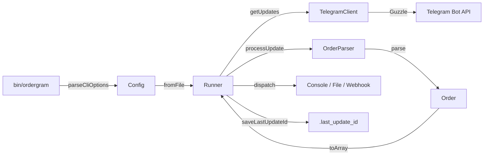

<!-- header:start -->
<div align="center">



<a href="#-quick-start"></a>

<a href="LICENSE"></a>

<a href="https://github.com/ajendras/ordergram/stargazers"></a>
<a href="https://github.com/ajendras/ordergram/actions/workflows/ci.yml"></a>

<a href="CONTRIBUTING.md"></a>

**PHP CLI scraper that monitors Telegram groups for ORDER_PLACED messages, parses them, and routes structured order events**

[✨ Features](#-features) • [⚡ Quick start](#-quick-start) • [🧰 Usage](#-usage) • [🧩 Architecture](#-architecture) • [📍 Roadmap](#-roadmap) • [🤝 Contributing](#-contributing)

</div>
<!-- header:end -->

## ✨ Why OrderGram?

Many services and trading groups push order confirmations into Telegram. OrderGram fills the gap with a tiny, zero-bloat PHP tool that polls a group, detects ORDER_PLACED keywords, extracts key fields, and forwards clean JSON events. Perfect for automation enthusiasts, indie developers and small e-commerce teams who want self-hosted control.

- **Zero-dependency polling** — Long-polling via the Telegram Bot API with automatic `last_update_id` persistence
- **Configurable regex parser** — `OrderParser` extracts `order_id`, `amount`, `customer` and metadata using patterns from `config.json`
- **Multiple outputs** — Console, append-only JSONL file, or POST to any `webhook_url` — all controlled by the `outputs` array
- **CLI-first & testable** — Supports `--once`, `--dry-run` and full PHPUnit coverage of message variants

## 🎬 Demo

<p align="center"></p>

## 🚀 Features

<table>
<tr>
<td>
📡 <b>Telegram Polling</b><br>
Long-polling via Bot API with automatic offset tracking
</td>
<td>
🔍 <b>Smart Parser</b><br>
Regex-based extraction of order ID, amount, customer and items
</td>
<td>
🚀 <b>Webhook Dispatch</b><br>
POSTs parsed orders to any configured HTTP endpoint
</td>
</tr>
<tr>
<td>
💾 <b>Update Tracking</b><br>
Persists last_update_id to avoid reprocessing messages
</td>
<td>
📤 <b>Multiple Outputs</b><br>
Console logging, JSONL file, or webhook with dry-run support
</td>
<td>
⚙️ <b>Simple Config</b><br>
Single JSON file with token, chat_id, patterns and outputs
</td>
</tr>
<tr>
<td>
🏷️ <b>CLI Flags</b><br>
--config, --once, --dry-run and --help for easy testing
</td>
<td>
🧪 <b>Tested Core</b><br>
PHPUnit suite covering many ORDER_PLACED message variants
</td>
<td>
📦 <b>Immutable DTO</b><br>
Order class guarantees valid structured events
</td>
</tr>
</table>

## 📦 Installation

**Requirements:** PHP 8.2+, Composer, and a Telegram bot token.

```bash
composer install
cp config.example.json config.json
# Edit config.json with your bot_token and chat_id
```

## ⚡ Quick start

```bash
cp config.example.json config.json
# Update bot_token, chat_id (negative for groups) and parse_patterns
php bin/ordergram --config=config.json
```

The runner will start a long-polling loop, parse any message matching the `detect` regex, and output structured events.

## 🧰 Usage

Run with the default config:

```bash
php bin/ordergram
```

One-shot mode (ideal for cron):

```bash
php bin/ordergram --once --config=config.json
```

Dry-run to test parsing without side effects:

```bash
php bin/ordergram --dry-run --config=config.example.json
```

<details><summary>Custom parse patterns for different order formats</summary>

Edit the `parse_patterns` object in `config.json`:

```json
"parse_patterns": {
    "detect": "/\\b(ORDER_PLACED|New Order|Purchase Confirmed)\\b/i",
    "order_id": "/Order #?([A-Z0-9-]+)/i",
    "amount": "/Total[:\\s$]*([0-9.]+)/i",
    "customer": "/from ([^\\n]+)/i"
}
```

Then run normally — `OrderParser` will use the new rules.
</details>

## 🔧 Configuration

| Option            | Default                  | Description |
|-------------------|--------------------------|-----------|
| `bot_token`       | (required)               | Telegram Bot API token in `123456:AAF...` format |
| `chat_id`         | (required)               | Chat ID to monitor (negative for groups/supergroups) |
| `poll_timeout`    | `30`                     | Long-poll timeout in seconds (max 60) |
| `last_update_file`| `.last_update_id`        | File storing the last processed `update_id` |
| `outputs`         | `["console"]`            | Array of enabled outputs: `console`, `file`, `webhook` |
| `webhook_url`     | `null`                   | HTTP endpoint that receives JSON order payloads |
| `file_path`       | `orders.jsonl`           | Path for append-only JSON Lines output |
| `parse_patterns`  | (required object)        | Regex map containing at minimum a `detect` key plus optional `order_id`, `amount`, `currency`, `customer`, `items` |

All validation happens in `Config::fromFile()`.

## 🧩 Architecture



`Runner` orchestrates the infinite polling loop (or one-shot mode). `TelegramClient` handles all Bot API communication with offset tracking. `OrderParser` uses the configured regexes to turn raw text into an immutable `Order` DTO, which is then routed to every enabled output. Errors are caught gracefully so the monitor stays alive.

## 📁 Project structure

```text
.
├── bin/
│   └── ordergram              # CLI entrypoint: parses flags, prints banner, creates Config/Runner
├── src/
│   ├── Config.php             # Loads & validates JSON, provides typed getters
│   ├── TelegramClient.php     # Guzzle wrapper for getUpdates(), acknowledge(), buildUrl()
│   ├── OrderParser.php        # Regex parser returning Order or null
│   ├── Order.php              # Immutable DTO with fromParsed() and toArray()
│   └── Runner.php             # Main loop, processUpdate(), dispatch() to console/file/webhook
├── config.example.json        # Ready-to-copy template with patterns and outputs
├── composer.json              # PSR-4 autoload, guzzlehttp/guzzle, phpunit script
└── .last_update_id            # Created at runtime to persist offset
```

## 🧪 Testing

```bash
composer test
# or
vendor/bin/phpunit
```

The suite covers `Config` validation, `OrderParser` handling of many ORDER_PLACED message variants, `Order` DTO invariants, and `Runner` output paths (including dry-run mode).

## 📍 Roadmap
<!-- roadmap:start -->
- [x] **v0.1.0** — first release: Telegram Polling, Smart Parser, Webhook Dispatch, Multiple Outputs
- [ ] Persist last_update_id to JSON file instead of memory
- [ ] Add support for multiple target chat_ids
- [ ] Implement exponential backoff on API errors
- [ ] Support environment variable substitution in config
- [ ] Add CSV export output handler
- [ ] Configurable custom regex patterns per group
- [ ] Dockerfile + example docker-compose for daemon mode
- [ ] Command to generate a sample ORDER_PLACED message for testing
- [ ] Basic logging to daily-rotated file
- [ ] Support MadelineProto user sessions for private groups without bots
- [ ] Add --webhook-test flag that sends a dummy order
- [ ] Rate-limit safeguard and graceful shutdown on SIGINT

> 🤖 This roadmap is worked through continuously — ideas and PRs welcome!
<!-- roadmap:end -->

## 🤝 Contributing

Contributions are welcome and appreciated! Please read [CONTRIBUTING.md](https://github.com/ajendras/ordergram/blob/main/CONTRIBUTING.md) and follow our [CODE_OF_CONDUCT.md](https://github.com/ajendras/ordergram/blob/main/CODE_OF_CONDUCT.md).

Good first issues include adding new output processors, improving regex patterns for specific merchants, or expanding test coverage of edge-case Telegram messages. Open a PR against the `main` branch — every merged PR gets a shout-out in the release notes.

## 📄 License

MIT © OrderGram. See [LICENSE](LICENSE) for details.

<!-- footer:start -->
<div align="center">

### ⭐ Star history

<a href="https://star-history.com/#ajendras/ordergram&Date"></a>

If **OrderGram** saves you time, a ⭐ helps others find it.

Made with ❤️ by [Ajendra](https://ajendra.info)


</div>
<!-- footer:end -->
